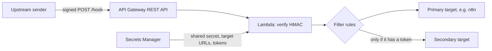

# aws-webhook-relay

I built this to put a signature check in front of an n8n webhook. An upstream system signs each webhook with HMAC-SHA256, and this relay checks the signature before it forwards the untouched body to n8n. It can also send the same body to a second target, with JSON rules that drop events that target has no use for.

It's API Gateway, one Node 22 Lambda and one Secrets Manager secret, deployed with CDK. The payloads are Autotask-style ticket events, but the relay only cares about the signature unless you turn on filtering. All fixtures and IDs in this repo are made up.



## What happens to a request

1. API Gateway exposes only `POST /hook`. It treats every body as binary, so the Lambda gets the exact bytes the sender signed.
2. The Lambda reads the secret on every request. If the secret or the filter config won't load or is invalid, it returns `500`.
3. It checks the signature. A missing or wrong signature, or a version other than `v1`, returns `401`.
4. It builds the target list. The secondary target is used only when the secret has both `SECONDARY_URL` and `SECONDARY_AUTH_TOKEN`.
5. If the filter rules drop the event, any target listed in `filterTargets` is skipped.
6. The remaining targets get the body in parallel. Each request times out after `forwardTimeoutMs`.
7. The relay returns `202` if any target answered 2xx or any target was filtered. Otherwise it returns `502`. The `202` body has `accepted`, `targets` (requests attempted) and `filtered` when it isn't zero.

Each target gets only these headers: `Content-Type` (default `application/json`), `X-Relay-Source` and `X-Autotask-Signature` if the sender set them, `X-Relay-Verified: true`, `X-Relay-Request-Id`, and `X-Relay-Token` when that target has a token in the secret. Nothing else passes through, including the relay signature. The relay doesn't check `X-Autotask-Signature`. It just passes it on.

## Signing spec

- `X-Relay-Signature` is the HMAC-SHA256 of the raw request body, keyed with the UTF-8 bytes of `SharedSecret`, as 64 lowercase hex characters with no prefix.
- `X-Relay-Signature-Version` is the literal `v1`.

Header names are case insensitive. The relay compares digests with `crypto.timingSafeEqual`. Sign the bytes you send. If you parse and re-serialise the JSON after signing, whitespace or key order can change and the check fails.

A Node sender:

```js
const crypto = require("crypto");
const fs = require("fs");

const body = fs.readFileSync("fixtures/ticket-update.json");
const signature = crypto.createHmac("sha256", process.env.RELAY_SHARED_SECRET)
  .update(body).digest("hex");

fetch(process.env.RELAY_URL, {
  method: "POST",
  headers: {
    "Content-Type": "application/json",
    "X-Relay-Signature": signature,
    "X-Relay-Signature-Version": "v1",
  },
  body,
}).then((response) => console.log(response.status));
```

With curl and OpenSSL. This puts the key in the process list, so only use it with a throwaway test key:

```bash
SIGNATURE=$(openssl dgst -sha256 -hmac "$TEST_KEY" fixtures/ticket-update.json | awk '{print $NF}')
curl -i -X POST "$RELAY_URL" \
  -H 'Content-Type: application/json' \
  -H "X-Relay-Signature: $SIGNATURE" \
  -H 'X-Relay-Signature-Version: v1' \
  --data-binary @fixtures/ticket-update.json
```

`scripts/sign-and-send.js` does the same from `RELAY_URL` and `RELAY_SHARED_SECRET`. `--dry-run` prints the headers and a curl command instead of sending. That signature can be replayed, so keep the output private.

```bash
cp .env.example .env   # then fill in the URL and secret
node --env-file=.env scripts/sign-and-send.js fixtures/ticket-update.json --dry-run
node --env-file=.env scripts/sign-and-send.js fixtures/ticket-update.json
```

## Configuration

The CDK app reads each key from context (`-c key=value`) first, then the environment, then `config.json`. Environment names are `RELAY_` plus upper snake case, so `forwardTimeoutMs` becomes `RELAY_FORWARD_TIMEOUT_MS`. Arrays and objects passed through context or the environment must be JSON strings. The stack has no default account, region, target or network, and it lists every missing required key in one error. `config.example.json` runs without a VPC or filter rules, and synths without AWS credentials.

| Key | Required | Notes |
| --- | --- | --- |
| `account`, `region` | No | Left unresolved at synth if unset. |
| `vpcEnabled` | Yes | `false` creates no VPC resources. |
| `primaryUrl` | Unless using an existing secret | Seeds `PRIMARY_URL` in the new secret. |
| `secondaryUrl` | No | Seeds `SECONDARY_URL`. It gets no traffic until you add `SECONDARY_AUTH_TOKEN`. |
| `secretArn` or `secretName` | No | Use an existing secret instead of creating one. Set one, not both. |
| `timeoutSeconds` | Yes | Lambda timeout, 29 at most. |
| `forwardTimeoutMs` | Yes | Per-target timeout. Must be under `(timeoutSeconds - 2) * 1000`. |
| `memorySize` | Yes | Lambda memory in MB. The example uses 128. |
| `logRetentionDays` | Yes | Must be a retention period CloudWatch accepts. The example uses 30. |
| `rateLimit`, `burstLimit` | Yes | API Gateway stage throttling. |
| `filterRules` | No | See below. Omitted or `{}` forwards everything. |
| `filterTargets` | No | `"primary"`, `"secondary"` or both. Omitted or `[]` filters nothing. |
| `vpcId`, `subnetIds`, `availabilityZones`, `securityGroupId`, `createSecretsManagerEndpoint` | In VPC mode | `subnetIds` and `availabilityZones` must be the same length and in matching order. |

### The secret

Without `secretArn` or `secretName`, the stack creates a secret with a generated 64-character alphanumeric `SharedSecret`, plus the URLs from config. It doesn't print the value. Copy it from Secrets Manager to the sender after deploying. An existing secret needs the same shape:

```json
{
  "SharedSecret": "replace-with-a-long-random-value",
  "PRIMARY_URL": "https://n8n.example.com/webhook/router",
  "PRIMARY_AUTH_TOKEN": "optional",
  "SECONDARY_URL": "https://secondary.example.com/webhook/router",
  "SECONDARY_AUTH_TOKEN": "required-if-SECONDARY_URL-is-set"
}
```

Only `SharedSecret` and `PRIMARY_URL` are required. Add tokens in Secrets Manager, not in config files or command arguments.

Changing `primaryUrl` or `secondaryUrl` on a generated secret can make CloudFormation regenerate it, which replaces `SharedSecret` and loses tokens you added by hand. If you plan to edit the secret yourself, create it outside CDK and pass `secretArn` or `secretName`. A customer-managed KMS key on an imported secret needs its own decrypt grant for the Lambda role.

### VPC mode

Leave `vpcEnabled` false if your targets are public. In VPC mode the stack imports the VPC, subnets and security group by ID. It doesn't change the group's rules or create a VPC, NAT gateway or routes. The group needs outbound access to your targets and to Secrets Manager on 443.

`createSecretsManagerEndpoint: true` adds a Secrets Manager interface endpoint with private DNS and a security group allowing 443 from the Lambda's group. It only reaches Secrets Manager, so public targets still need a NAT route. A public subnet doesn't help, because Lambda never gets a public IP.

## Filter rules

Filtering cuts noise for a target that would otherwise run, and bill, for events it ignores. The stack passes `filterRules` to the Lambda as `RELAY_FILTER_RULES`, and `filterTargets` as `RELAY_FILTER_TARGETS`. `filter-rules.example.json` is a reference copy and nothing reads it. Unknown keys or wrong types fail at synth and again at runtime.

```json
{
  "entityTypes": ["ticket", "ticketnote"],
  "alwaysForwardStatuses": [9001, 9002],
  "actionableStatuses": [9003, 9004],
  "requireUpdateActionFor": ["ticket"]
}
```

The relay applies these checks in order and stops at the first one that decides:

1. Anything it can't read is forwarded. That covers invalid JSON, arrays, payloads wrapped in a `body` key, a missing entity, no fields object, non-numeric statuses, and change objects like `{"old": 9001, "new": 9003}`.
2. The entity comes from `EntityType`, `entityType`, `entity`, `Entity` or `resource`, lowercased. If `entityTypes` is set and the entity isn't in it, the event is dropped.
3. If neither status list is set, the event is forwarded.
4. Statuses come from any key in the fields object (`Fields`, `fields`, `Changes`, `changes`, `changedFields`, `Change` or `change`) that reads `status` once punctuation is stripped, plus a top-level `Status` or `status`. A fields object with no status is dropped.
5. A status in `alwaysForwardStatuses` is forwarded.
6. No status in `actionableStatuses` means the event is dropped.
7. If `requireUpdateActionFor` is set, the entity must be in it and the action (`Action`, `action`, `event` or `Event`) must be `update`, case insensitive. `updated` doesn't count. A missing action is forwarded.

With the example rules, `non-ticket.json` is dropped and the other three fixtures are forwarded.

## Security notes

- The signature proves the body came from someone with the secret. There's no timestamp or nonce, so a captured request can be replayed.
- The endpoint is public with no API key or IAM auth. Bad requests still cost a secret read and a Lambda run. Stage throttling is the only limit, so put a WAF in front if the endpoint gets probed.
- Outbound requests follow redirects, and the target's `X-Relay-Token` goes with them. Only point the relay at targets you control.
- HTTP target URLs are accepted. Use HTTPS unless the target is private.
- If a target can be reached directly, it should check `X-Relay-Token`. `X-Relay-Verified` alone proves nothing.
- Logs hold request IDs, target names, HTTP statuses and filter reasons. They never include bodies, secrets, tokens or target URLs.
- Rotating `SharedSecret` has no overlap period. Change the sender and the secret together.

## Known limitations

A request returns `202` when one target filtered the event, even if the other target failed. The sender won't retry, so that delivery is lost. One success and one failure also returns `202`. This avoids duplicate deliveries on retry, but it means `202` doesn't promise every target got the event. There are no retries, no queue and no deduplication.

## Rough cost

These are US region list prices before free tier, for 100,000 requests a month at 128 MB and one second per request.

| Part | Per month |
| --- | --- |
| Lambda | About $0.23 |
| Secrets Manager, one secret plus 100,000 reads | About $0.90 |
| API Gateway REST API | About $0.35 |
| Secrets Manager interface endpoint, if created | About $7.30 per AZ, plus data |
| NAT gateway, if your VPC targets need one | About $33 per gateway, plus $0.045/GB |

Without a VPC that's about $1.50 a month plus logs. In VPC mode the endpoint or NAT gateway costs far more than everything else combined. The stack never creates a NAT gateway.

## Deploy and tear down

```bash
npm install
cp config.example.json config.json   # edit before deploying
npm run check                        # node --check on every JS file
npm test                             # signature, filter and handler tests, no AWS needed
npx cdk synth
npx cdk bootstrap                    # once per account and region
npx cdk deploy WebhookRelayStack
```

The stack outputs `RelayHookUrl`, `RelayConfigSecretName` and `RelayLogGroupName`. Point the sender at `RelayHookUrl`, give it `SharedSecret`, and add any target tokens to the secret. Then send a fixture with the script above.

```bash
npx cdk destroy WebhookRelayStack
```

The generated secret and the log group are kept on destroy, so delete them by hand using the output names. A Secrets Manager endpoint created by the stack is removed with it. Imported secrets and VPC resources are never touched.

## License

MIT
